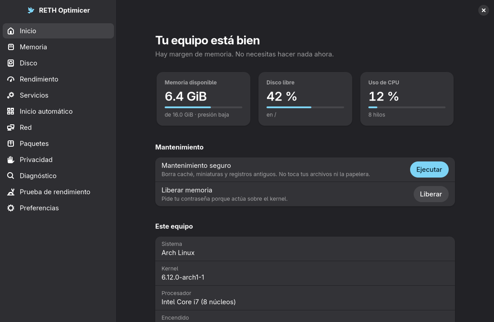
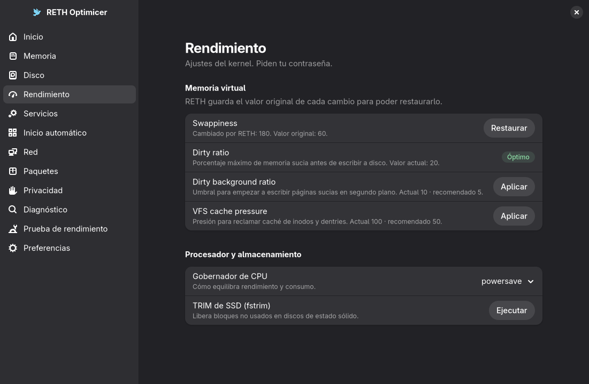
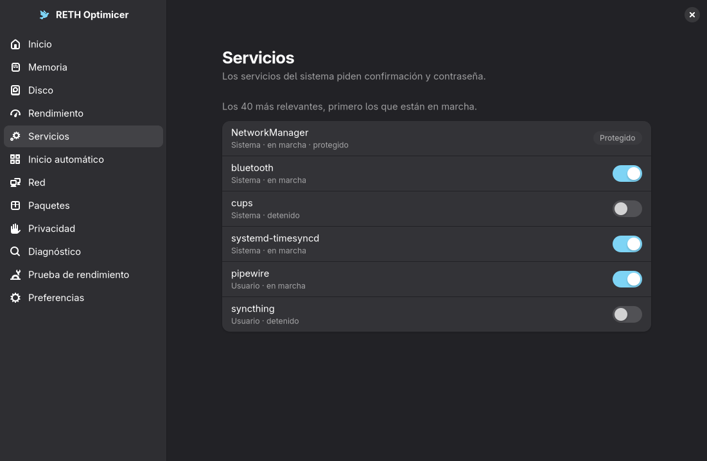

<p align="center"></p>

<p align="center"><b>Diagnóstico y mantenimiento seguro para Windows y Linux.</b><br/>
Un producto de <b>RETH Tecnologías</b> · software, soporte técnico e infraestructura · Lima, Perú</p>

<p align="center">
<a href="https://github.com/dzenwertz/Win-Optimicer-Cchay/releases">Descargar</a> ·
<a href="CHANGELOG.md">Novedades</a> ·
<a href="linux/README.md">Linux</a> ·
<a href="docs/SUPPORT_REPORT.md">Reporte de soporte</a> ·
<a href="LICENSE">GPL-3.0</a>
</p>

---

RETH Optimicer muestra en una sola pantalla cómo están la memoria, el disco y el procesador, y ofrece un mantenimiento que no toca tus archivos personales. **Cada cambio en el sistema se puede deshacer**: en Windows crea un punto de restauración antes de aplicarlo (y te avisa si no puede), y en Linux guarda el valor original para restaurarlo con un clic. Solo pide permisos de administrador después de explicar para qué los usa.



## Características

| | |
| --- | --- |
| **Diagnóstico claro** | Memoria disponible, disco libre, uso de CPU y qué aplicaciones consumen más. |
| **Cambios reversibles** | Punto de restauración en Windows; botón «Restaurar» en Linux. |
| **Mantenimiento seguro** | Limpia caché, miniaturas y registros antiguos; no toca documentos ni la papelera. |
| **Control del sistema** | Servicios, inicio automático, DNS con latencia medida, privacidad y diagnóstico de arranque. |

<table>
<tr>
<td></td>
<td></td>
</tr>
<tr>
<td align="center">Rendimiento: «Óptimo», «Aplicar» y «Restaurar»</td>
<td align="center">Servicios con interruptores</td>
</tr>
</table>

Capturas de la versión Linux con datos de demostración.

## Descargar

Los paquetes están en [Releases](https://github.com/dzenwertz/Win-Optimicer-Cchay/releases), con `SHA256SUMS.txt` para verificar la integridad.

| Sistema | Requisitos | Cómo usarlo |
| --- | --- | --- |
| **Windows 10/11 (x64)** | Build 19041 o posterior | Extrae `RETH-Optimicer-Windows-portable-*.zip` y ejecuta `RethOptimicer.exe` |
| **Linux** | Python 3.10+, GTK 4, libadwaita 1.4+, polkit | Extrae `RETH-Optimicer-Linux-*.tar.gz` y ejecuta `sudo ./install.sh` dentro de `linux/` |

**Permisos.** En Windows la app se abre sin privilegios, explica para qué necesita ser administrador y lo pide; si no aceptas, funciona en modo diagnóstico. En Linux, las acciones de administrador (liberar RAM, sysctl, servicios del sistema, DNS) usan `pkexec` y solo están disponibles con la instalación del sistema (`sudo ./install.sh`).

Las acciones de mantenimiento modifican la configuración del equipo. Revisa cada operación antes de aplicarla. RETH Optimicer no promete mejoras de FPS ni reparar cualquier problema.

## Compilar

**Windows** (SDK de .NET 8):

```powershell
git clone https://github.com/dzenwertz/Win-Optimicer-Cchay.git
cd Win-Optimicer-Cchay
dotnet publish cchay-optimicer-cs/cchay-optimicer-cs.csproj -c Release -r win-x64 --self-contained true -o publish
```

**Linux** (revisa el script antes de ejecutarlo):

```bash
git clone https://github.com/dzenwertz/Win-Optimicer-Cchay.git
cd Win-Optimicer-Cchay/linux
sudo ./install.sh
reth-optimicer
```

Sin `sudo` se instala solo para tu usuario y las acciones de administrador quedan desactivadas.

## Pruebas

```bash
cd linux
python3 -m unittest tests.test_modules tests.test_safety tests.test_reverts
```

```powershell
dotnet test cchay-optimicer-cs-tests
```

El workflow [CI](https://github.com/dzenwertz/Win-Optimicer-Cchay/actions) ejecuta todas las pruebas de Linux y compila Windows con las pruebas de reporte. Las pruebas usan datos ficticios y no ejecutan mantenimiento real.

## Estructura

```text
cchay-optimicer-cs/        App Windows (C#, .NET 8, WPF)
cchay-optimicer-cs-tests/  Pruebas Windows
linux/                     App Linux (Python, GTK 4, libadwaita) y helper con lista blanca
installer/                 Instalador Inno Setup
website/                   Landing del producto
entrega-reth/              Ficha y capturas para la web de RETH
docs/                      Documentación de soporte
```

## Estado

Versión **3.1.0**. Linux: pruebas automáticas y recorrido completo de la interfaz. Windows: compilado en el CI y probado el portable de la release en un Windows 11 Pro 25H2 recién instalado (arranque sin privilegios, explicación de permisos, reinicio como administrador y aviso cuando no se puede crear el punto de restauración). Detalle en el [CHANGELOG](CHANGELOG.md).

## Licencia y contacto

Desarrollado por **Joseph Ivan Cachay Vargas · RETH Tecnologías**. Código bajo [GPL-3.0](LICENSE).

Para reportar un fallo, abre un [issue](https://github.com/dzenwertz/Win-Optimicer-Cchay/issues) con sistema operativo, versión, pasos y mensaje de error. Elimina nombres de usuario, direcciones y otros datos personales de los registros.
