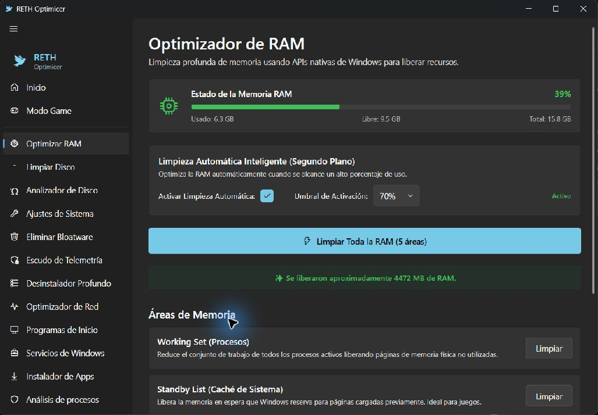

<p align="center"></p>

# RETH Optimicer
**Diagnóstico y mantenimiento de equipos Windows y Linux.**

Proyecto personal de [Joseph Cachay](https://github.com/dzenwertz), orientado a explorar tareas de soporte TI: consultar recursos, revisar procesos y servicios, identificar problemas y ofrecer acciones de mantenimiento.

[Descargar v3.0.0](https://github.com/dzenwertz/Win-Optimicer-Cchay/releases/tag/v3.0.0) · [Código Windows](cchay-optimicer-cs) · [Código Linux](linux) · [Cambios](CHANGELOG.md) · [GPL-3.0](LICENSE)

## Interfaz Windows



Captura real de la instalación local de Joseph, tomada el 26 de octubre de 2026. No identifica un artefacto de release reproducido: la interfaz y los módulos del código publicado pueden diferir. Los valores de memoria son una lectura puntual, no un benchmark de rendimiento.

## Qué puedes revisar

| Área | Implementación |
| --- | --- |
| Diagnóstico | Información de CPU, memoria, discos y red |
| Mantenimiento | Módulos de temporales, memoria, procesos, inicio y servicios |
| Conectividad | Herramientas de DNS y ajustes de red |
| Recuperación | Funciones de respaldo y puntos de restauración |
| Distribución | Portable Windows, paquete Linux y workflows de GitHub Actions |

Las acciones de mantenimiento pueden eliminar datos o modificar la configuración del equipo. Revisa cada operación y realiza una copia de seguridad antes de usarla. El proyecto no promete mejoras de FPS ni una reparación automática de cualquier problema.

## Valor para soporte TI

El código permite explicar la separación entre **observar un síntoma, diagnosticar y ejecutar una acción**. Los servicios Windows y módulos Linux son puntos de entrada para revisar cómo se consultan recursos del sistema y se gestionan operaciones con permisos elevados.

Es un proyecto personal de portafolio; no representa un despliegue empresarial ni un producto auditado para producción.

### Reportes para documentar una incidencia

El código actual omite usuario e IP del reporte exportado y propone un nombre de archivo sin el nombre del equipo. Conserva los datos técnicos y explica los límites del puntaje. Consulta el [flujo de soporte y la verificación del reporte](docs/SUPPORT_REPORT.md). Este cambio de código no actualiza automáticamente el portable v3.0.0.

## Descargar y ejecutar

La [release v3.0.0](https://github.com/dzenwertz/Win-Optimicer-Cchay/releases/tag/v3.0.0) incluye estos archivos:

| Archivo | Uso |
| --- | --- |
| `RETH-Optimicer-Windows-portable-v3.0.0.zip` | Windows 10/11 x64; extraer y ejecutar `RethOptimicer.exe` |
| `RETH-Optimicer-Linux-v3.0.0.tar.gz` | Código y scripts para Linux con GTK 4/libadwaita |
| `RETH-Optimicer-Windows-installer-scripts-v3.0.0.zip` | Scripts del instalador; no es un instalador compilado |
| `SHA256SUMS.txt` | Comprobaciones de integridad publicadas |

Windows: requiere Windows 10 build 19041 o posterior; algunas operaciones solicitan permisos de administrador. Linux: Python 3.10+, GTK 4, libadwaita y polkit para acciones privilegiadas. Consulta las instrucciones específicas de [Linux](linux/README.md).

## Compilar Windows

Instala el SDK de .NET 8 y las herramientas de escritorio de Windows.

```powershell
git clone https://github.com/dzenwertz/Win-Optimicer-Cchay.git
cd Win-Optimicer-Cchay
dotnet restore cchay-optimicer-cs/cchay-optimicer-cs.csproj
dotnet publish cchay-optimicer-cs/cchay-optimicer-cs.csproj -c Release -r win-x64 --self-contained true -o publish
```

## Instalar Linux desde el código

Revisa el script antes de ejecutarlo; la instalación añade archivos al sistema.

```bash
git clone https://github.com/dzenwertz/Win-Optimicer-Cchay.git
cd Win-Optimicer-Cchay/linux
chmod +x install.sh
./install.sh
reth-optimicer
```

## Mapa del código

```text
cchay-optimicer-cs/
  Views/                   Pantallas WPF
  Services/                Diagnóstico y acciones Windows
cchay-optimicer-cs-tests/   Pruebas .NET
linux/
  reth_optimicer/           Aplicación y módulos Python
  tests/                   Pruebas de módulos
installer/                 Scripts de instalación
website/                   Web y recursos de marca
.github/workflows/         Integración y publicación
```

## Verificación

Para ejecutar las suites disponibles en un entorno preparado:

```powershell
dotnet test cchay-optimicer-cs-tests
```

```bash
cd linux
python3 -m unittest tests.test_modules
```

El workflow `CI` ejecuta pruebas de módulos Linux y compila el proyecto Windows al ejecutar el grupo `SystemReportTests`. Estas pruebas usan datos ficticios y no ejecutan mantenimiento. No validan la interfaz ni todas las acciones del sistema. Revisa el resultado de cada ejecución en [Actions](https://github.com/dzenwertz/Win-Optimicer-Cchay/actions).

## Estado y próximos pasos

La release publicada y el código en desarrollo pueden diferir. Antes de ampliar funcionalidades, las prioridades son documentar resultados de diagnóstico, hacer visibles los errores y comprobar cada operación de mantenimiento en un entorno de pruebas.

## Autoría y licencia

Proyecto de **Joseph Ivan Cachay Vargas / RETH**. Código bajo [GPL-3.0](LICENSE). Para reportar un fallo, indica sistema operativo, versión, pasos y mensaje de error; elimina nombres de usuario, direcciones y otros datos personales de los registros.
